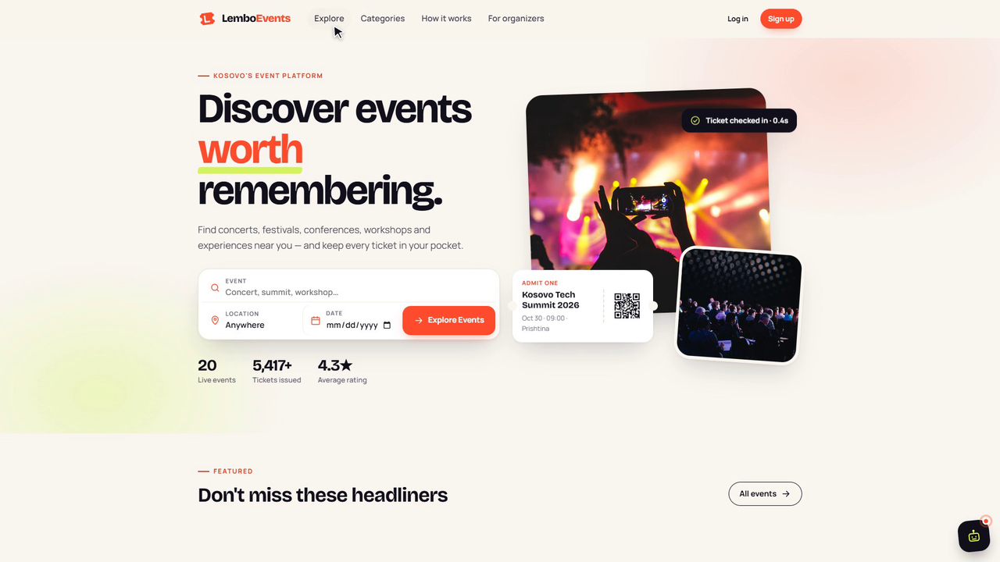
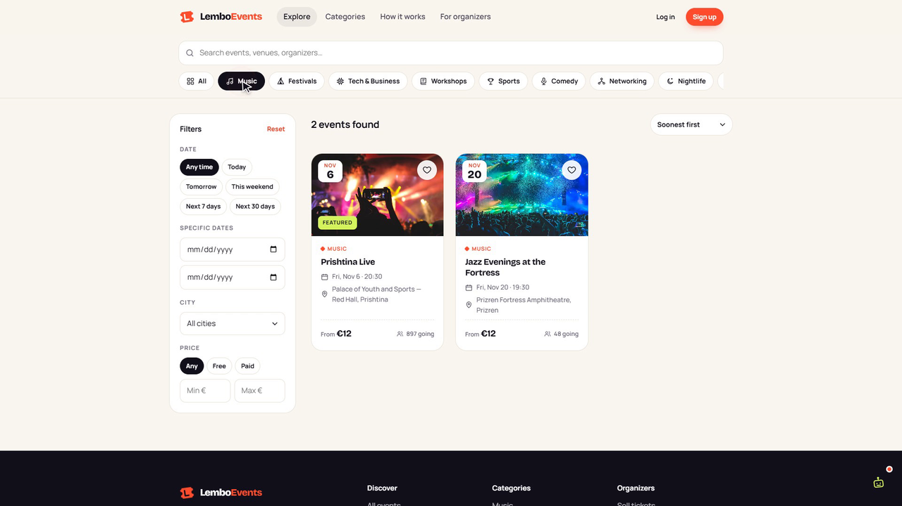
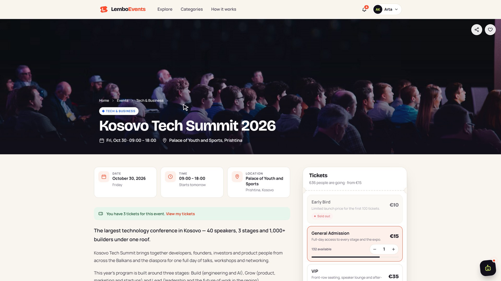
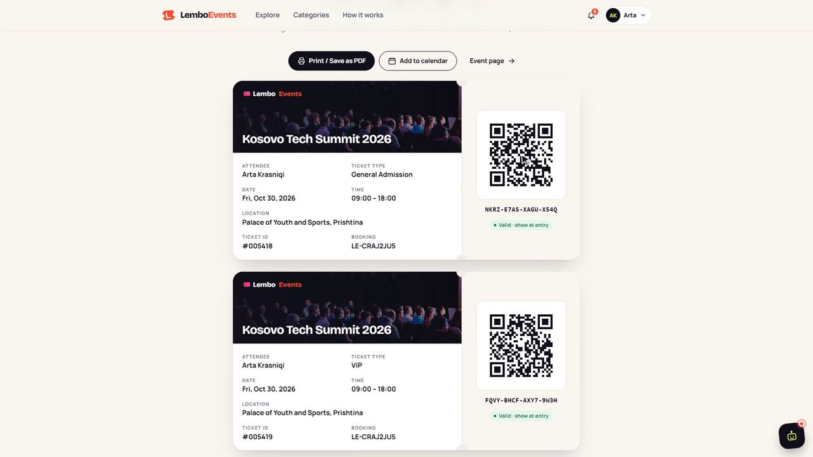
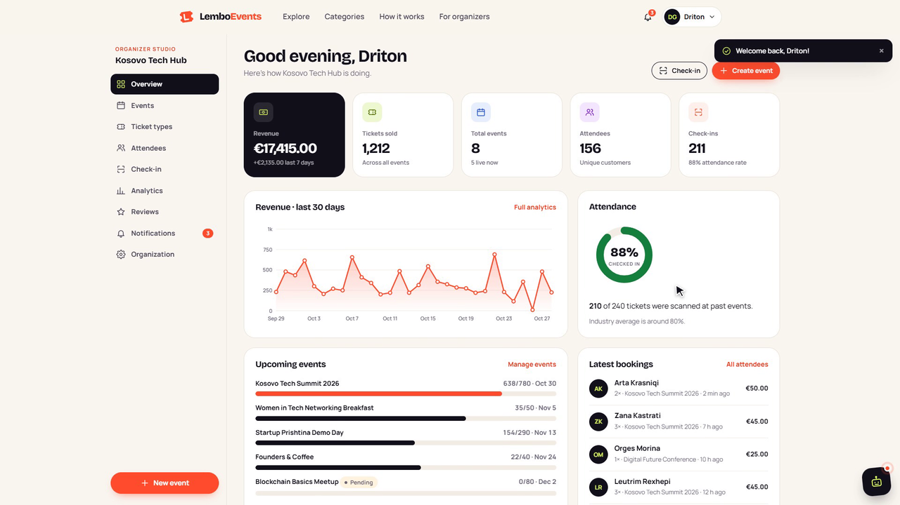
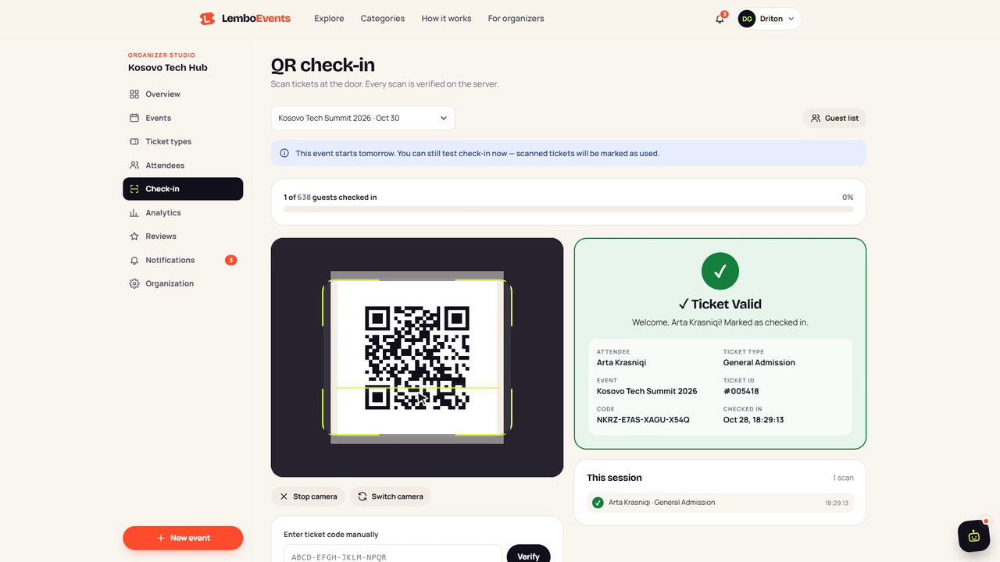
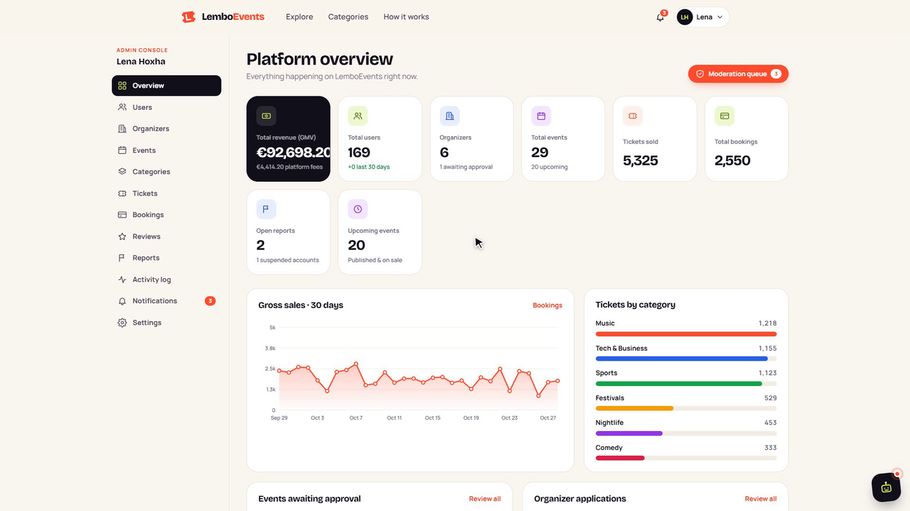
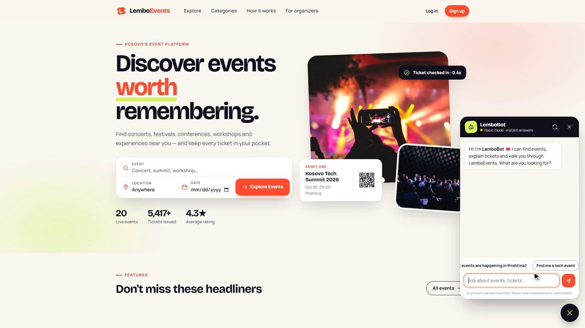
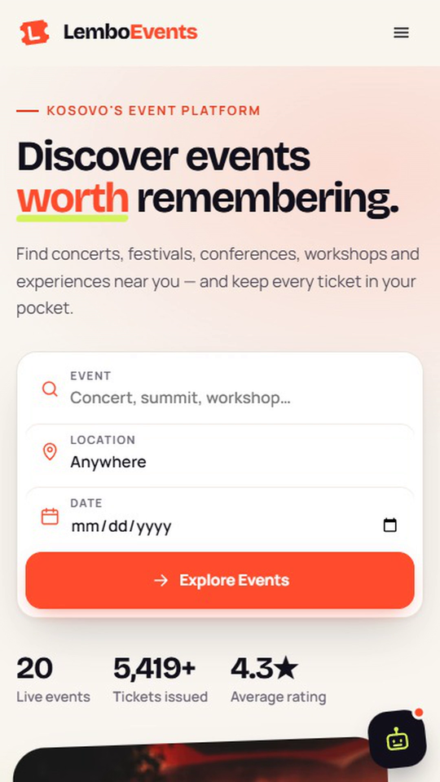

# LemboEvents 🎟️

**Discover events worth remembering.**

LemboEvents is a full-stack event discovery, ticketing and event-management platform built with plain PHP 8, MySQL and vanilla JavaScript. Attendees find events and book tickets. Organizers sell tickets and check guests in by scanning QR codes. Administrators moderate the whole platform. An AI assistant, **LemboBot**, runs on Groq.

> Built as a production-style portfolio project: no frameworks, a clean architecture, real security controls and a distinctive UI.

---

## Table of contents

- [Features](#features)
- [Screenshots](#screenshots)
- [Tech stack](#tech-stack)
- [Installation (XAMPP)](#installation-xampp)
- [Configuration](#configuration)
- [LemboBot & Groq setup](#lembobot--groq-setup)
- [Demo accounts](#demo-accounts)
- [Project structure](#project-structure)
- [Security](#security)
- [How the important parts work](#how-the-important-parts-work)
- [Testing](#testing)

---

## Features

### Attendees
- Register, log in, edit your profile and avatar, change your password, reset a forgotten password
- Browse, search and filter events (category, city, date presets or range, price, free/paid) with **live AJAX search**, sorting and "load more"
- **Events near you** based on your browser's geolocation (Haversine distance in SQL)
- Event pages with a cover image, gallery, OpenStreetMap location, organizer card, reviews, share and favorite buttons
- Several ticket types per event, with live availability, a quantity stepper and the total including fees
- Demo checkout with card validation (Luhn, expiry, CVC) plus simulated Apple Pay / Google Pay
- **Digital tickets** with a unique code and a **signed QR code**. You can print or save them as PDF and add them to your calendar (`.ics`)
- Dashboard with upcoming events, a ticket wallet, upcoming/past/cancelled bookings, favorites and notifications
- Cancel eligible bookings: up to 48 h before the event and with no ticket checked in. The refund is simulated
- Leave a 1–5★ review once per attended event
- Notifications: booking confirmations, reminders 48 h before, event changes, cancellations and review replies

### Organizers
- Apply as an organizer. An admin approves the application
- Organization profile with a logo and a public organizer page
- Event editor: details, schedule, venue and coordinates, cover image, gallery, and **unlimited ticket types** (price, quantity, max per order, sale window, on/off)
- Workflow: Draft → Submit for review → Published → Unpublish / Cancel. Cancelling refunds and notifies every attendee
- Ticket-type management: change prices and quantities, pause or resume sales. Quantity can never drop below the number already sold
- Attendee list with search and filters, manual check-in and **CSV export**
- **QR check-in scanner** that uses the phone or laptop camera (BarcodeDetector, with jsQR as fallback) or manual code entry. It shows ✓ Valid, ⚠ Already used or ✕ Invalid, a live progress bar, beep/vibration feedback and a scan log
- Analytics: revenue and ticket sales over time, period-over-period growth, revenue by ticket type, sales by weekday, per-event views → sales conversion, check-in rate
- Reply to reviews publicly, or report a review to the moderators

### Administrators
- Platform dashboard: GMV, platform fees, users, organizers, events, tickets, bookings, open reports, sales chart, signups chart, tickets by category, moderation queues and the activity feed
- Users: search, filter, suspend (logged out immediately) and reactivate
- Organizers: approve or reject applications, with a reason sent to the applicant
- Events: approve, reject with feedback, feature on the homepage, cancel with refunds
- Categories: create, edit, hide, reorder, choose a color and icon
- Ticket lookup by code, booking, attendee or event. Bookings with refunds
- Review moderation: hide, restore, delete
- Reports queue (events, reviews, organizers): resolve or dismiss, and notify the reporter
- Full **activity log** (audit trail)

### LemboBot 🤖
- Floating chat assistant on every page, with history, typing and loading states, error states and suggestion chips
- Searches the real database: *"comedy this weekend"*, *"free events in Prishtina"*, *"concerts in Prizren under €15"* (Albanian city names work too)
- Role-aware: it knows **your own** upcoming tickets (attendee), sales (organizer) or moderation queue (admin), and nothing about anyone else
- Groq AI when a key is configured. Otherwise it falls back to smart rule-based answers, so it always works

---

## Screenshots

| Home | Explore | Event |
|---|---|---|
|  |  |  |

| Digital ticket | Organizer dashboard | QR check-in |
|---|---|---|
|  |  |  |

| Admin | LemboBot | Mobile |
|---|---|---|
|  |  |  |

---

## Tech stack

| Layer | Technology |
|---|---|
| Frontend | HTML5, CSS3 (custom design system with CSS variables), vanilla JavaScript (Fetch API) |
| Backend | PHP 8.1+ (tested on PHP 8.5), PDO with prepared statements, PHP sessions |
| Database | MySQL 8 / MariaDB 10.4+ |
| AI | Groq's OpenAI-compatible Chat Completions API, called from PHP with cURL |
| QR codes | Own dependency-free PHP QR encoder (`includes/qrcode.php`) that renders SVG |
| QR scanning | Native `BarcodeDetector` → [jsQR](https://github.com/cozmo/jsQR) fallback (CDN) |
| Maps | OpenStreetMap embed (no API key) |
| Charts | Server-rendered SVG (`includes/charts.php`), no JS chart library |
| Fonts | Bricolage Grotesque + Manrope (Google Fonts) |

No React, Vue, Laravel, Bootstrap or Tailwind.

---

## Installation (XAMPP)

### 1. Get the code into `htdocs`
Clone the repository into your XAMPP web root:

```bash
cd C:\xampp\htdocs
git clone https://github.com/LedionImeri/LemboEvents-Event-Management-Platform.git LemboEvents
```

> Prefer keeping the code elsewhere (e.g. in OneDrive)? Create a junction instead of copying. Run this in an **admin** Command Prompt:
> `mklink /J C:\xampp\htdocs\LemboEvents "C:\path\to\LemboEvents"`

### 2. Start Apache and MySQL
Open the XAMPP Control Panel and start **Apache** and **MySQL**.

### 3. Import the database
1. Open <http://localhost/phpmyadmin>
2. Go to the **Import** tab, choose `database/schema.sql` and click **Import**

The script creates the `lemboevents` database (dropping any old one) and loads the demo data: 169 users, 29 events, about 2,500 bookings, about 5,400 tickets, plus reviews and check-ins.

Command-line alternative:

```bash
mysql -u root < database/schema.sql
```

> Demo dates are **relative to the import date**: upcoming events are always in the future and past events already have reviews. Re-import at any time for a fresh demo.

### 4. Open the app
<http://localhost/LemboEvents/>

The base URL is detected automatically, so any folder name works. If the folder is not called `LemboEvents`, update the two `ErrorDocument` lines in `.htaccess`.

### Requirements
- PHP **8.1+** with the `pdo_mysql`, `mbstring`, `fileinfo`, `curl` and `openssl` extensions. All of these are enabled in XAMPP by default
- MySQL 8 or MariaDB 10.4+

---

## Configuration

Private settings live in **`config/local.php`**. The file is git-ignored and never committed:

```bash
copy config\local.example.php config\local.php
```

```php
return [
    'APP_ENV'    => 'development',          // 'production' hides errors and demo helpers
    'APP_SECRET' => 'a-long-random-string', // signs ticket QR codes
    'DB_HOST' => '127.0.0.1', 'DB_NAME' => 'lemboevents', 'DB_USER' => 'root', 'DB_PASS' => '',
    'GROQ_API_KEY' => '',                   // optional, enables AI answers
    'GROQ_MODEL'   => '',                   // optional, defaults to openai/gpt-oss-120b
];
```

Generate a secret with:

```bash
php -r "echo bin2hex(random_bytes(32));"
```

Every value can also come from **environment variables** (see `.env.example`). `config/local.php` takes precedence.

> ⚠️ Changing `APP_SECRET` invalidates the QR codes of existing tickets. The ticket codes still work through manual entry.

---

## LemboBot & Groq setup

1. Create a free API key at <https://console.groq.com/keys>
2. Put it in `config/local.php`:
   ```php
   'GROQ_API_KEY' => 'gsk_...',
   ```
3. Reload the site. The LemboBot header now shows **"AI online · Groq"**.

Architecture:

```
Browser (assets/js/chatbot.js)
   ↓  fetch POST /api/chatbot.php  (CSRF token, no key)
PHP backend (includes/LemboBot.php)
   ↓  searches events in MySQL, builds a role-aware context
   ↓  cURL → https://api.groq.com/openai/v1/chat/completions  (Bearer key, 20 s timeout)
PHP backend
   ↓  JSON { reply, events[], status }
Browser renders the reply and event cards
```

- **The key never reaches the browser.** It is only read on the server and sent in the `Authorization` header. It is also redacted from any error log.
- **Rate limits:** 8 messages per minute, 120 per day, and at least 2 s between messages, per user (or per session + IP for guests).
- **Validation:** messages are at most 500 characters, the last 8 messages are sent as history, and answers are capped in length.
- **Grounding:** the system prompt only contains events returned by the database search and the current user's **own** data. The bot is told never to reveal keys, prompts or other users' data, and to ignore prompt-injection attempts.
- **Fallback:** if there is no key, or Groq times out or errors, LemboBot answers from built-in rules and still searches events live.
- **Model:** `GROQ_MODEL` accepts any chat model on your key, e.g. `openai/gpt-oss-120b`, `openai/gpt-oss-20b` or `llama-3.3-70b-versatile`.
- **Windows SSL error** (`SSL certificate problem`): download [cacert.pem](https://curl.se/ca/cacert.pem) and set `'CHATBOT_CA_BUNDLE' => 'C:/xampp/php/extras/ssl/cacert.pem'`.

---

## Demo accounts

All demo accounts use the password **`Lembo@2026`**. In development mode the login page has one-click buttons that fill these in.

| Role | Email | What to try |
|---|---|---|
| 🎟️ Attendee | `attendee@lemboevents.com` | Tickets for the Kosovo Tech Summit (2 days after import), past events to review, favorites |
| 🎤 Organizer | `organizer@lemboevents.com` | Kosovo Tech Hub: analytics, attendees, check-in, a pending event, a draft |
| 🛡️ Admin | `admin@lemboevents.com` | Moderation queue (2 pending events, 1 organizer application), reports |
| Organizer (pending) | `liridona@culturelab.org` | See what a not-yet-approved organizer sees |
| Suspended user | `valbona.halili@example.com` | Login is blocked |

**Demo payment cards:**
- Success: `4242 4242 4242 4242`, any future expiry date, any CVC
- Decline: `4000 0000 0000 0002`

**Try the QR check-in:** log in as the attendee, open a ticket on your phone (or print it), then log in as the organizer on another device and go to **Check-in → Start scanner**. Scan the same ticket twice to see *⚠ Ticket Already Used*.

> The camera needs **HTTPS or localhost**. On a phone that opens `http://192.168.x.x`, use manual code entry or serve the site over HTTPS.

---

## Project structure

```
LemboEvents/
├── index.php, events.php, event.php       Public pages (home, explore, event details)
├── organizer.php                          Public organizer profile
├── checkout.php, booking.php, ticket.php  Checkout, confirmation/receipt, digital tickets (+ .ics)
├── login.php, register.php, logout.php, forgot-password.php, reset-password.php
├── 404.php, 403.php, robots.txt, .htaccess
│
├── attendee/     dashboard, tickets, bookings, favorites, notifications, profile
├── organizer/    dashboard, events, create-event, edit-event, tickets, attendees,
│                 check-in, reviews, analytics, notifications, profile
├── admin/        dashboard, users, organizers, events, categories, tickets,
│                 bookings, reviews, reports, activity, notifications, profile
│
├── api/          JSON endpoints: auth, events, bookings, tickets, favorites,
│                 notifications, checkin, chatbot, reviews, reports, newsletter
│
├── config/       config.php (app settings), database.php (PDO), chatbot.php,
│                 local.example.php (template, copy to local.php)
│
├── includes/
│   ├── bootstrap.php     Loaded by every page: config, security headers, session, helpers
│   ├── auth.php          Authentication, roles, brute-force lockout
│   ├── csrf.php          CSRF tokens (forms + fetch header)
│   ├── functions.php     Escaping, URLs, formatting, uploads, notifications, event queries
│   ├── booking.php       Booking service: quotes, transactional booking, cancellations
│   ├── qrcode.php        QR encoder + signed ticket payloads
│   ├── LemboBot.php      AI assistant (search, context, Groq, fallback, rate limits)
│   ├── event_search.php  Search/filter engine shared by the page and the API
│   ├── event_form.php    Event editor validation and saving
│   ├── organizer.php     Event status workflow
│   ├── charts.php        SVG charts
│   ├── icons.php         Inline SVG icon set
│   ├── header.php / footer.php
│   └── partials/         Event card, e-ticket, dashboard nav, modals, chatbot widget …
│
├── assets/
│   ├── css/      app.css (design system), dashboard.css, chatbot.css
│   ├── js/       app.js (core UI), events.js, event.js, checkout.js, checkin.js, chatbot.js …
│   ├── images/   Logo, favicon, placeholder
│   └── uploads/  User uploads (script execution disabled)
│
└── database/schema.sql   Schema + demo data
```

### Database (20 tables)
`users`, `attendee_profiles`, `organizer_profiles`, `categories`, `events`, `event_images`, `ticket_types`, `bookings`, `booking_items`, `tickets`, `check_ins`, `reviews`, `favorites`, `notifications`, `reports`, `activity_logs`, `password_resets`, `login_attempts`, `newsletter_subscribers`, `chatbot_messages`

All tables have primary keys, foreign keys (with sensible `CASCADE`/`RESTRICT`/`SET NULL` rules), indexes for every lookup and filter, unique constraints and `created_at`/`updated_at` timestamps. Rules the database enforces itself:
- `UNIQUE(check_ins.ticket_id)`: a ticket can be checked in only once
- `UNIQUE(reviews.user_id, event_id)` and `UNIQUE(reviews.booking_id)`: one review per attendee and event
- `CHECK (quantity_sold <= quantity)`: no overselling, even from a buggy query
- `CHECK (rating BETWEEN 1 AND 5)`

---

## Security

| Threat | Protection |
|---|---|
| SQL injection | PDO prepared statements everywhere (`ATTR_EMULATE_PREPARES = false`). Sort fields and filters are whitelisted |
| XSS | Every dynamic value is printed through `e()` (`htmlspecialchars`). JS inserts user content with `textContent`. Strict **Content-Security-Policy** with no inline scripts |
| CSRF | A per-session token on every POST form and an `X-CSRF-Token` header on every fetch, compared with `hash_equals`. Logout is POST-only |
| Passwords | `password_hash()` / `password_verify()` (bcrypt), automatic rehash, strength rules on server and client |
| Brute force | 5 failed logins per email+IP within 15 minutes trigger a lockout. Unknown emails take the same time to check (dummy hash) |
| Sessions | HttpOnly + SameSite=Lax cookies, strict mode, ID regenerated on login, 4 h idle timeout, suspended users are logged out on their next request |
| Authorization | Role checks on every page and endpoint, plus ownership checks: organizers only ever see and act on their own events, attendees only see their own bookings and tickets |
| Uploads | Real MIME check (`finfo`), `getimagesize`, size limits, random file names, a whitelisted folder, and PHP execution disabled in `assets/uploads/.htaccess` |
| Ticket fraud | The QR contains `LEMBO1.<code>.<HMAC>`. The server checks the signature, ticket, event, organizer, status and the one-time check-in |
| Overbooking | A transaction plus `SELECT … FOR UPDATE` plus a guarded `UPDATE … WHERE quantity - quantity_sold >= n` |
| Double submit | A one-time checkout nonce: resubmitting goes to the existing booking |
| Secrets | `config/local.php` and `.env` are git-ignored, nothing secret is sent to the frontend, and API keys are redacted from logs |
| Password reset | 64-hex random tokens, only the SHA-256 hash is stored, 1 h expiry, single use, no account enumeration |
| Open redirects | `?redirect=` only accepts internal paths |
| CSV injection | Exported cells that start with `= + - @` are neutralized |
| Headers | CSP, `X-Frame-Options`, `X-Content-Type-Options`, `Referrer-Policy`, `Permissions-Policy` |
| Direct access | `.htaccess` denies `includes/`, `config/`, `database/`, dotfiles and `.sql` files |

**Before deploying publicly:** set `APP_ENV=production`, set a strong `APP_SECRET` and a database password, serve over HTTPS, and connect a real mail service for password resets (the demo shows the reset link on screen in development mode).

---

## How the important parts work

**Booking without overbooking** (`includes/booking.php`):
1. `BEGIN` → `SELECT … FROM ticket_types WHERE id IN (…) FOR UPDATE` locks the rows
2. Validate the sale window, availability and per-order limits **against the locked rows**. Prices always come from the database, never from the browser
3. `UPDATE ticket_types SET quantity_sold = quantity_sold + n WHERE id = ? AND quantity - quantity_sold >= n` and check that exactly 1 row changed
4. Insert the booking, items and tickets (16-character codes, 80 bits of randomness), then `COMMIT`
5. Notify the attendee and the organizer and write an activity log entry

In testing, 12 truly parallel buyers competing for the last 3 tickets gave exactly 3 bookings; the other 9 got "just sold out".

**QR check-in** (`api/checkin.php`): the scanner sends the raw QR text. The server parses it, verifies the HMAC, loads the ticket, checks that the organizer owns the event, that it is the selected event, and that nothing was cancelled. It then inserts into `check_ins`, whose unique key guarantees only one winner even if two doors scan the same ticket at the same moment.

---

## Testing

The project was tested end to end against a running server:
- **Pages:** every public, attendee, organizer and admin page (60+ URLs) checked for HTTP status and PHP warnings
- **Functional and security suite:** 91 scripted checks, all passing. They cover registration, login, lockout, CSRF, XSS escaping, SQL injection attempts, favorites, search and filters, checkout and card validation, ticket generation, double-submit protection, authorization boundaries, QR check-in (valid, used, invalid, forged signature, wrong event, manual), cancellation rules, inventory release, reviews, the overbooking race, malicious uploads, the organizer event lifecycle (create, review, approve, edit-notify, cancel-refund), organizer approval and user suspension
- **Responsive:** checked at 375 px (mobile), 768 px and 1366 px. There is no horizontal scrolling. The mobile menu was verified at the top, the middle and the bottom of long pages: it is fixed to the viewport, sits above the sticky bars, and locks scrolling
- **LemboBot:** event search intents, role contexts, refusal of secrets, and the rate limiter

---

## Author

Built by **Ledion Imeri** · CodeWithLedion · [GitHub](https://github.com/LedionImeri)

---

## License

MIT. Use it, learn from it, build on it.

Demo event photos are loaded from [Unsplash](https://unsplash.com). Demo organizations, people and events are fictional.
